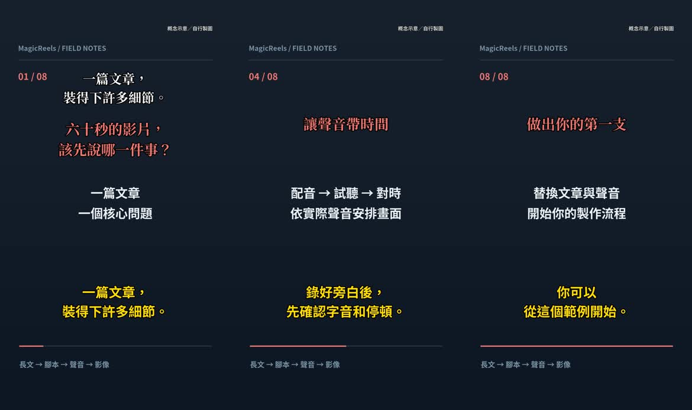

# MagicReels

**把長文，做成有自己聲音的繁中短影音。**

## 最簡單的用法：把專案連結交給 AI

把下方指令貼到 **ChatGPT Codex** 或 **Claude Code**，接著提供文章與你有權使用的參考聲音，請 AI 依照專案規則協助製作：

```text
請使用這個專案，幫我製作一支繁體中文直式短影音：
https://github.com/billtoutw/MagicReels

請先閱讀 README.md、AGENTS.md、docs/workflow.md 與 docs/qwen3-tts.md，
依照專案規則準備環境、腳本、Qwen3-TTS 配音、素材、字幕與配樂。
配音使用 Qwen3-TTS 1.7B Base，透過 MLX Audio 在 Apple Silicon Mac 本機生成，
搭配我的參考錄音與逐字稿複製聲線。
我接著會提供文章及參考聲音；缺少必要資料時，請告訴我。
請先讓我確認腳本、短段讀音與完整旁白，再合成影片，
最後交付 MP4、繁中字幕、來源清單與驗證紀錄。
```

AI 使用的環境需能下載專案並執行 Python／FFmpeg。v0.4 的配音入口適用於 Apple Silicon Mac，準備 3–30 秒乾淨錄音與相符逐字稿；Pexels 金鑰按需要設在本機環境變數。AI 會依文件處理安裝與缺少的輸入。首次使用 Qwen3-TTS 需要下載數 GB 模型；其他平台可匯入已生成的音檔製片。

想先體驗成品，可以補一句「請先跑內附的完整示範」；示範已附旁白，能先確認剪輯與字幕環境。[代理工作規則](AGENTS.md)與[Qwen 配音及讀音修訂](docs/qwen3-tts.md)也可直接交給 AI 參考。

## 專案與示範

MagicReels 是一套可重現、保留人工審核的製作工具包。從文章改寫提示詞開始，以 **Qwen3-TTS 1.7B Base（BF16）透過 MLX Audio 在 Mac 本機生成配音，搭配使用者的參考錄音複製聲線**，編排素材與圖卡，輸出 1080 × 1920 影片及繁中字幕，再匯入配樂完成混音。

本流程直接呼叫 MLX Audio，無須安裝 Voicebox App。Voicebox 曾作為工具研究的參考；目前公開入口為 `magicreels-qwen`。

v0.4.0 · Python 3.11+ · FFmpeg / libass · 本機 CLI

[觀看完整示範（53 秒 MP4，沿用 v0.2）](https://github.com/billtoutw/MagicReels/releases/download/v0.2.0/MagicReels-demo-v0.2.0.mp4) · [下載 v0.4.0](https://github.com/billtoutw/MagicReels/releases/tag/v0.4.0) · [查看示範輸入](examples/first-reel)



## 先跑完整示範

安裝 Python 3.11+、Git 和含 `libass` 的 FFmpeg。以下指令從倉庫根目錄執行：

```sh
git clone https://github.com/billtoutw/MagicReels.git
cd MagicReels
python3 -m venv .venv
. .venv/bin/activate
python -m pip install -r requirements.txt
export PEXELS_API_KEY='your-key'
python examples/first-reel/fetch_materials.py
magicreels validate examples/first-reel/project.json
magicreels render examples/first-reel/project.json --out work/demo-film-v1
magicreels mix work/demo-film-v1/film.mp4 \
  --music examples/first-reel/music.wav --out work/demo-mix-v1
```

示範採 6 段 Pexels 動態影片與 2 張概念圖卡，保留 v0.2 的 BreezyVoice 示範旁白與配樂，聲音來源維持原始標示。觀看成品可直接開啟上方 MP4；重建請設定自己的免費 Pexels API key，執行下載腳本，再驗證與合成。配音已附於範例，無須另外下載語音模型。重跑時請換新的輸出目錄。

在 macOS 可用 `brew install ffmpeg`；Ubuntu 可用 `sudo apt-get install ffmpeg`。請以 `ffmpeg -filters` 確認有 `ass` 濾鏡。

## 製作自己的影片

| 步驟 | 操作與產出 | 人工確認 |
| --- | --- | --- |
| 1. 文章 → 腳本 | 將 [文章改寫提示詞](prompts/article-to-script.md) 與文章交給你使用的 LLM | 核對事實、正式名稱、主線與口白 |
| 2. 腳本 → 聲音 | 按 [Qwen3-TTS 安裝與操作](docs/qwen3-tts.md) 生成分段音檔與 `audio-map.json` | 先聽短段，再聽完整音軌 |
| 3. 聲音 → 分鏡 | 複製示範的 `project.json`；依音訊段落安排圖卡、照片或影片 | 核對素材身分、來源與字幕斷行 |
| 4. 合成 | `magicreels validate`，再執行 `magicreels render` | 手機尺寸檢查與完整觀看 |
| 5. 音樂 → 完成 | 用 [配樂提示詞](prompts/music.md) 在 ElevenLabs 產生並下載音樂，執行 `magicreels mix` | 全片試聽人聲清晰度 |

輸入格式、局部修訂與指令見 [製作指南](docs/workflow.md)。Codex 或其他程式代理可以依此文件協作；步驟也可從一般終端機執行。文章改寫與 ElevenLabs 操作由使用者選擇的服務完成。

### 素材搜尋

```sh
# 在本機終端機設定自己的金鑰，勿寫入倉庫。
export PEXELS_API_KEY='your-key'
magicreels search 'person reading an article' --out work/search-v1
magicreels fetch 123456 --out work/asset-v1  # 將 123456 換成搜尋結果的 video_id
```

以 Pexels 動態影片優先，直式素材置中裁切為 1080×1920 滿版；缺少適合畫面或需要說明概念時再用圖卡。搜尋結果保存作者、來源頁與素材 ID，下載後附三張取樣圖。請觀看實際取段後設定 `reviewed: true`。

完整教學見 [Pexels 素材取得與使用](docs/pexels.md)，包括金鑰、搜尋、下載、分鏡及授權範圍。Pexels 素材依其授權使用，原始片段保存在 Git 忽略目錄；來源由 [Pexels](https://www.pexels.com) 提供。

### 配音與字幕

Qwen3-TTS 採獨立 Python 3.11 環境，固定 MLX Audio 0.4.1 與 1.7B Base BF16 模型版本。參考聲音及精確逐字稿由使用者提供，正常稿與合成稿分開保存。每個句段的實際音檔邊界形成字幕時間表。需要字詞層級檢查時，可安裝 `python -m pip install -e '.[align]'` 並執行 `magicreels transcribe` 取得 Whisper 逐字時間；依試聽結果修正時間表。

中英夾雜先檢查英文名稱的連讀、重音與前後語氣。Qwen 可在合成稿使用經試聽的同音字或數字讀法，字幕保留正常文字；規則見 [Qwen 配音指南](docs/qwen3-tts.md)。可沿用固定核准的聲線／風格參考，新內容由本機生成，再逐段試聽。舊 [BreezyVoice 入口](docs/breezyvoice.md)與[注音方法](docs/breezyvoice-code-switching.md)保留供歷史專案重現。

### 固定版型

- 9:16、1080 × 1920、30 fps、H.264 / AAC。
- 思源黑體繁中粗體黃色字幕，最多兩行；思源宋體繁中粗體的白色引題與珊瑚紅問句。
- 右上角來源、暗色素材背景、動態影片滿版裁切，以及約 390 px 寬的檢查圖。
- 來源 ID 與檔案雜湊防止同一素材再次插入。變形或重新編碼的素材仍須靠來源 ID 與人工核對。
- 音樂以緩慢音量曲線調整，保存人聲成分與時間，混音前後比對解碼畫格。

## v0.4 範圍與現況

v0.4 將主要配音流程接到 Qwen3-TTS 1.7B Base／MLX Audio，新增 `magicreels-qwen`、獨立安裝說明、正常稿與合成稿分離的讀音修訂，以及保留 24 kHz／24-bit PCM 的音訊映射。使用參考錄音及逐字稿生成新文字，全程保留人工試聽步驟。

本版支援單支 1–180 秒影片、一套固定版型、本機 Qwen3-TTS、Pexels 搜尋、原創圖卡、照片／影片、逐段字幕與匯入配樂。CTA 可作為時間軸尾段，使用獨立素材。

服務帳號、雲端部署、批次發布、社群排程與線上編輯器留待需求驗證。影片事實、聲音聽感、素材身分與最終觀感由製作者確認。

本次測試與限制見 [v0.4 驗證紀錄](docs/verification-v0.4.md)，既有示範的畫面與聲音驗證保留於 [v0.2 紀錄](docs/verification-v0.2.md)。Qwen 配音入口目前針對 Apple Silicon；先完成短段試行再投入長片。

## 來源與授權

MagicReels 整理自實際的 Reelsturbo 製作流程。工作流起點為 [MoneyPrinterTurbo](https://github.com/harry0703/MoneyPrinterTurbo)，本倉庫抽出繁中編輯規格與獨立命令列工具，並明確保留各上游的來源。

本專案程式與原創文件採 [MIT](LICENSE)。Qwen3-TTS、MLX Audio、BreezyVoice、字型、素材、音樂與服務條款各自適用，詳見 [第三方來源](THIRD_PARTY_NOTICES.md)。私人參考聲音、金鑰與既有客戶素材均由使用者保留在本機。

## 開發與回報

```sh
python -m unittest discover -s tests -v
```

回報問題時附操作指令、作業系統、FFmpeg 版本與可公開的最小範例。請先移除金鑰、個人聲音與未公開稿件。改善建議歡迎以 Issue 討論；維護方式見 [CONTRIBUTING.md](CONTRIBUTING.md)。
