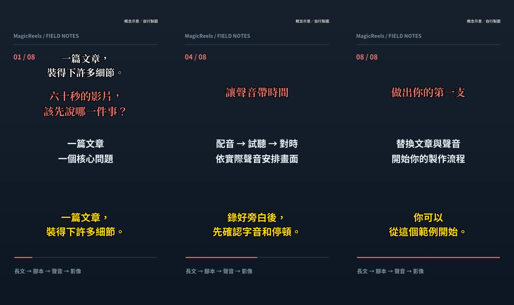

# MagicReels

**把長文，做成有自己聲音的繁中短影音。**

## 最簡單的用法：把專案連結交給 AI

把下方指令貼到 **ChatGPT Codex** 或 **Claude Code**，接著提供文章與你有權使用的參考聲音，請 AI 依照專案規則協助製作：

```text
請使用這個專案，幫我製作一支繁體中文直式短影音：
https://github.com/billtoutw/MagicReels

請先閱讀 README.md、AGENTS.md、docs/workflow.md 與 docs/voicestudio.md，
依照專案規則準備環境、腳本、VoiceStudio 配音、素材、字幕與配樂。
請依我的作業系統與硬體選擇 VoiceStudio 配音方式，使用我的參考錄音與逐字稿。
Apple Silicon Mac 使用 MagicReels 的自動配音入口。其他桌面平台依下方說明，
由 VoiceStudio 桌面版生成並匯出 WAV，再接回 MagicReels 的音訊映射和字幕流程。
我接著會提供文章及參考聲音；缺少必要資料時，請告訴我。
請先讓我確認腳本、短段讀音與完整旁白，再合成影片，
最後交付 MP4、繁中字幕、來源清單與驗證紀錄。
```

AI 使用的環境需能下載專案並執行 Python／FFmpeg。準備 3–30 秒乾淨錄音與相符逐字稿。Apple Silicon Mac 可使用 [VoiceStudio 自動配音入口](docs/voicestudio.md)，其他桌面平台可依下方 [VoiceStudio 跨平台配音](#cross-platform-audio)匯入 WAV。Pexels 金鑰按需要設在本機環境變數。首次使用 Qwen3-TTS 需要下載數 GB 模型。

想先體驗成品，可以補一句「請先跑內附的完整示範」。示範已附旁白，能先確認剪輯與字幕環境。[代理工作規則](AGENTS.md)與 [VoiceStudio 配音指南](docs/voicestudio.md)也可直接交給 AI 參考。

## 專案與示範

MagicReels 是一套可重現、保留人工審核的製作工具包。從文章改寫提示詞開始，以 **VoiceStudio 搭配 Qwen3-TTS 1.7B Base（BF16）在 Mac 本機複製聲線並生成配音**，編排素材與圖卡，輸出 1080 × 1920 影片及繁中字幕，再匯入配樂完成混音。

Apple Silicon Mac 可使用 [`magicreels-voicestudio`](docs/voicestudio.md)自動配音。其他桌面平台透過 [VoiceStudio 桌面版匯出 WAV](#cross-platform-audio)，接回相同的影片製作流程。需要重現既有配音時可使用 [`magicreels-qwen`](docs/qwen3-tts.md)。

v0.4.0 · Python 3.11+ · FFmpeg / libass · 本機 CLI

[觀看完整示範（53 秒 MP4，沿用 v0.2）](https://github.com/billtoutw/MagicReels/releases/download/v0.2.0/MagicReels-demo-v0.2.0.mp4) · [下載 v0.4.0](https://github.com/billtoutw/MagicReels/releases/tag/v0.4.0) · [查看示範輸入](examples/first-reel)



## 先跑完整示範

安裝 Python 3.11+、Git 和含 `libass` 的 FFmpeg。以下指令從倉庫根目錄執行：

```sh
git clone https://github.com/billtoutw/MagicReels.git
cd MagicReels
python3 -m venv .venv
. .venv/bin/activate
python -m pip install -r requirements.txt
export PEXELS_API_KEY='your-key'
python examples/first-reel/fetch_materials.py
magicreels validate examples/first-reel/project.json
magicreels render examples/first-reel/project.json --out work/demo-film-v1
magicreels mix work/demo-film-v1/film.mp4 \
  --music examples/first-reel/music.wav --out work/demo-mix-v1
```

示範採 6 段 Pexels 動態影片與 2 張概念圖卡，保留 v0.2 的 BreezyVoice 示範旁白與配樂，聲音來源維持原始標示。觀看成品可直接開啟上方 MP4；重建請設定自己的免費 Pexels API key，執行下載腳本，再驗證與合成。配音已附於範例，無須另外下載語音模型。重跑時請換新的輸出目錄。

在 macOS 可用 `brew install ffmpeg`；Ubuntu 可用 `sudo apt-get install ffmpeg`。請以 `ffmpeg -filters` 確認有 `ass` 濾鏡。

## 製作自己的影片

| 步驟 | 操作與產出 | 人工確認 |
| --- | --- | --- |
| 1. 文章 → 腳本 | 將 [文章改寫提示詞](prompts/article-to-script.md) 與文章交給你使用的 LLM | 核對事實、正式名稱、主線與口白 |
| 2. 腳本 → 聲音 | 使用 [VoiceStudio 自動配音](docs/voicestudio.md)，或將 [桌面版 WAV](#cross-platform-audio)接入音訊映射 | 先聽短段，再聽完整音軌 |
| 3. 聲音 → 分鏡 | 複製示範的 `project.json`；依音訊段落安排圖卡、照片或影片 | 核對素材身分、來源與字幕斷行 |
| 4. 合成 | `magicreels validate`，再執行 `magicreels render` | 手機尺寸檢查與完整觀看 |
| 5. 音樂 → 完成 | 用 [配樂提示詞](prompts/music.md) 在 ElevenLabs 產生並下載音樂，執行 `magicreels mix` | 全片試聽人聲清晰度 |

輸入格式、局部修訂與指令見 [製作指南](docs/workflow.md)。Codex 或其他程式代理可以依此文件協作；步驟也可從一般終端機執行。文章改寫與 ElevenLabs 操作由使用者選擇的服務完成。

### 素材搜尋

```sh
# 在本機終端機設定自己的金鑰，勿寫入倉庫。
export PEXELS_API_KEY='your-key'
magicreels search 'person reading an article' --out work/search-v1
magicreels fetch 123456 --out work/asset-v1  # 將 123456 換成搜尋結果的 video_id
```

以 Pexels 動態影片優先，直式素材置中裁切為 1080×1920 滿版；缺少適合畫面或需要說明概念時再用圖卡。搜尋結果保存作者、來源頁與素材 ID，下載後附三張取樣圖。請觀看實際取段後設定 `reviewed: true`。

完整教學見 [Pexels 素材取得與使用](docs/pexels.md)，包括金鑰、搜尋、下載、分鏡及授權範圍。Pexels 素材依其授權使用，原始片段保存在 Git 忽略目錄；來源由 [Pexels](https://www.pexels.com) 提供。

### 配音與字幕

Apple Silicon 自動配音使用獨立 Python 3.11 環境、MLX Audio 0.5.0 與固定的 Qwen3-TTS 1.7B Base BF16 模型。參考聲音及精確逐字稿由使用者提供，正常稿與合成稿分開保存。`--script` 搭配 `--segments`，先以 `--plan-only` 核對語意段落。每段可含多個句子，完整送入模型。字幕於配音完成後按實際音訊另外對時，現有渲染器的較細 part 映射可由保留 PCM 的切片建立。需要字詞層級檢查時，可安裝 `python -m pip install -e '.[align]'` 並執行 `magicreels transcribe` 取得 Whisper 逐字時間，再依試聽結果修正時間表。

中英夾雜先檢查英文名稱的連讀、重音與前後語氣。Qwen 可在合成稿使用經試聽的同音字或數字讀法，字幕保留正常文字；規則見 [Qwen 配音指南](docs/qwen3-tts.md)。可沿用固定核准的聲線／風格參考，新內容由本機生成，再逐段試聽。舊 [BreezyVoice 入口](docs/breezyvoice.md)與[注音方法](docs/breezyvoice-code-switching.md)保留供歷史專案重現。

<a id="voicebox"></a>
<a id="cross-platform-audio"></a>

### VoiceStudio 跨平台配音

從 [VoiceStudio 官方發行頁](https://github.com/debpalash/VoiceStudio/releases/latest)選擇對應系統與架構。下表依 VoiceStudio v0.5.8 的桌面安裝資訊整理。

| 桌面平台 | VoiceStudio 安裝方式 | 配音方式 |
| --- | --- | --- |
| macOS（Apple Silicon） | ARM64 DMG。[安裝指南](https://github.com/debpalash/VoiceStudio/blob/v0.5.8/docs/install/macos.md) | 本機生成，可用 MagicReels 自動入口或桌面版匯出 WAV |
| macOS（Intel） | x64 DMG。[安裝指南](https://github.com/debpalash/VoiceStudio/blob/v0.5.8/docs/install/macos.md) | 使用桌面介面，連至另一台相容電腦的 VoiceStudio 後端生成 |
| Windows（x64） | x64 安裝程式。[安裝指南](https://github.com/debpalash/VoiceStudio/blob/v0.5.8/docs/install/windows.md) | 用相容的聲線複製引擎在桌面版生成並匯出 WAV |
| Windows（ARM64） | ARM64 實驗版安裝程式。[發行頁](https://github.com/debpalash/VoiceStudio/releases/tag/v0.5.8) | 先確認所選引擎可安裝和生成，再匯出 WAV |
| Linux（x64） | AppImage 或 `.deb`。[安裝指南](https://github.com/debpalash/VoiceStudio/blob/v0.5.8/docs/install/linux.md) | 用相容的聲線複製引擎在桌面版生成並匯出 WAV |

桌面版可用的聲線複製引擎及硬體加速取決於平台、驅動及所安裝的模型。先用有權使用的參考錄音與逐字稿試聽短段，再生成完整旁白，建議匯出 24-bit PCM WAV。[VoiceStudio 引擎清單](https://github.com/debpalash/VoiceStudio/blob/v0.5.8/docs/feature-catalog.md) · [WAV 設定](https://github.com/debpalash/VoiceStudio/blob/v0.5.8/docs/audio-quality.md)

桌面版 WAV 由製作者或程式代理按 [外部音檔銜接](docs/workflow.md#external-audio-handoff)建立 `audio-map.json` 與核准紀錄，再接回字幕、分鏡、合成及混音。MagicReels 的自動配音實測範圍為 Apple Silicon，各桌面平台的完整流程仍待實機驗證。

### 固定版型

- 9:16、1080 × 1920、30 fps、H.264 / AAC。
- 思源黑體繁中粗體黃色字幕，最多兩行；思源宋體繁中粗體的白色引題與珊瑚紅問句。
- 右上角來源、暗色素材背景、動態影片滿版裁切，以及約 390 px 寬的檢查圖。
- 來源 ID 與檔案雜湊防止同一素材再次插入。變形或重新編碼的素材仍須靠來源 ID 與人工核對。
- 音樂以緩慢音量曲線調整，保存人聲成分與時間，混音前後比對解碼畫格。

## v0.4 範圍與現況

v0.4 將主要配音流程接到 Qwen3-TTS 1.7B Base／MLX Audio，新增 `magicreels-qwen`、獨立安裝說明、正常稿與合成稿分離的讀音修訂，以及保留 24 kHz／24-bit PCM 的音訊映射。使用參考錄音及逐字稿生成新文字，全程保留人工試聽步驟。

本版支援單支 1–180 秒影片、一套固定版型、本機 Qwen3-TTS、Pexels 搜尋、原創圖卡、照片／影片、逐段字幕與匯入配樂。CTA 可作為時間軸尾段，使用獨立素材。

服務帳號、雲端部署、批次發布、社群排程與線上編輯器留待需求驗證。影片事實、聲音聽感、素材身分與最終觀感由製作者確認。

歷史版本的測試與限制見 [v0.4 驗證紀錄](docs/verification-v0.4.md)，既有示範的畫面與聲音驗證保留於 [v0.2 紀錄](docs/verification-v0.2.md)。新稿先完成短段試聽再生成完整旁白。

## 來源與授權

MagicReels 整理自實際的 Reelsturbo 製作流程。工作流起點為 [MoneyPrinterTurbo](https://github.com/harry0703/MoneyPrinterTurbo)，本倉庫抽出繁中編輯規格與獨立命令列工具，並明確保留各上游的來源。

本專案程式與原創文件採 [MIT](LICENSE)。Qwen3-TTS、MLX Audio、BreezyVoice、字型、素材、音樂與服務條款各自適用，詳見 [第三方來源](THIRD_PARTY_NOTICES.md)。私人參考聲音、金鑰與既有客戶素材均由使用者保留在本機。

## 開發與回報

```sh
python -m unittest discover -s tests -v
```

回報問題時附操作指令、作業系統、FFmpeg 版本與可公開的最小範例。請先移除金鑰、個人聲音與未公開稿件。改善建議歡迎以 Issue 討論；維護方式見 [CONTRIBUTING.md](CONTRIBUTING.md)。
